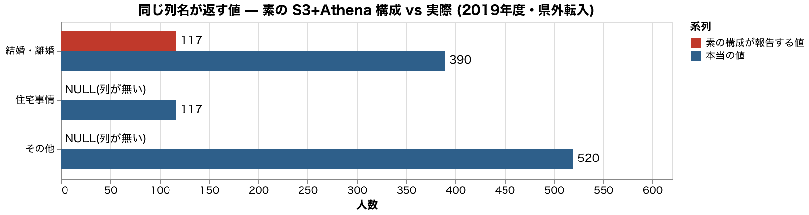
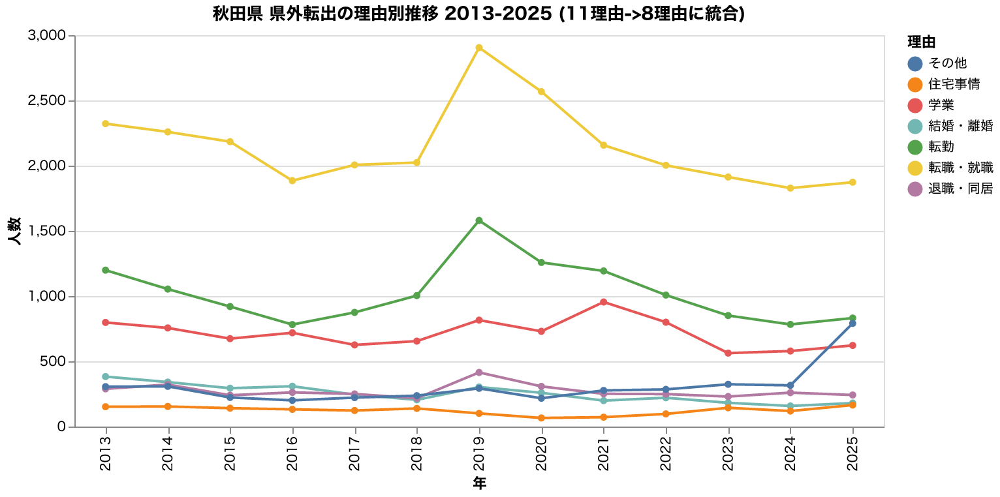

# 素の S3+Athena と S3 Tables は何が違うのか

実測値は `out/athena_vs_s3tables.json`。これを出していたノートブックは 2026-10-04 に
外したので、コミット済みの JSON が正本(生成コードは `git show 64c9f75:notebooks/athena_vs_s3tables.py`)。
`make check` で原稿との突き合わせができる。

題材は秋田県「人口移動理由実態調査」の 2013-2018 版(19列)と 2019-2025 版(16列)。
**2019 年に理由の分類そのものが 11 項目から 8 項目へ再編された**(統合・分割・削除が同時)。

| 2013-2018 (11理由) | 2019-2025 (8理由) |
| --- | --- |
| 転勤 | 転勤 |
| 転業・転職 / 就職 | 転職・就職 / 就職(学生) ← 境界が変わった |
| **家業後継** | **消滅** |
| 進学・転校 / 卒業 | 学業 ← 統合 |
| 結婚・離婚 | 結婚・離婚 |
| 親との同居 / 子・孫との同居 | 退職・同居 ← 統合 |
| 住宅事情 | 住宅事情 |
| その他 | その他 |

新しい版では全列の末尾に `（人）` が付いた。単位が列名に混ざっている。

## 何を模擬したか

Athena の CSV テーブルは **LazySimpleSerDe が列を位置で読む**。公式ドキュメントの
対応表は CSV/TSV について「先頭や途中への列追加は不可」「列を削除する必要があるなら
CSV/TSV を使うな」と明記している。

<https://docs.aws.amazon.com/athena/latest/ug/handling-schema-updates-chapter.html>

| 変更 | CSV / TSV | Parquet(名前読み) |
| --- | --- | --- |
| 列名の変更 | ○ | × |
| **先頭や途中への列追加** | **×** | ○ |
| **列の削除** | **非推奨** | ○ |
| 列の並べ替え | × | — |

ローカルでは DuckDB の
`read_csv(..., header=false, skip=1, columns=<固定19列>, null_padding=true, auto_detect=false)`
で同じ振る舞いを作った。テーブル定義は最初に作った版(19列)のまま、後から来た16列の
ファイルを同じ定義で読む状況になる。

> `auto_detect=false` が必要。付けないと DuckDB のスニファが「宣言19列 / 実ファイル16列」の
> 不一致を検出してエラーにする。Hive/Athena はこの検査をしないので、
> **スニファを止めることが Athena の振る舞いに寄せる操作になる。**

## 結果: エラーにならず、静かに間違う

2ファイル 1,521 行が1つのテーブルとして読める。**読み込みは成功する。**
2019年度・県外転入・男女計・総数の行で:

| 素の構成が報告する項目 | 報告値 | 値の実体 | この名前の本当の値 |
| --- | --- | --- | --- |
| 転業・転職 | 1017 | 転職・就職（人） | (旧分類・新版に無い) |
| 就職 | 384 | 就職（学生）（人） | (旧分類・新版に無い) |
| 家業後継 | 295 | 学業（人） | (2019年に廃止された分類) |
| 進学・転校 | 390 | 結婚・離婚（人） | (旧分類・新版に無い) |
| 卒業 | 926 | 退職・同居（人） | (旧分類・新版に無い) |
| **結婚・離婚** | **117** | 住宅事情（人） | **390** |
| 親との同居 | 520 | その他（人） | (旧分類・新版に無い) |
| 子・孫との同居 / 住宅事情 / その他 | NULL | (列が無い) | — / 117 / 520 |

**7列が別の項目の値を返し、3列が NULL 埋めになる。** 両方の版に同じ名前で存在する
`結婚・離婚` は 390 が正しいのに **117(住宅事情の値)** を返す。

## 健全性チェックでは検出できない

「総数 == 理由の合計」で検算しても壊れが見つからない。理由の**数字は全部そこにあり、
ラベルだけが入れ替わっている**ので合計は一致する。

| 版 | 行数 | 検算が一致した行 |
| --- | --- | --- |
| 2013-2018 | 702 | 702 (100%) |
| 2019-2025 | 819 | 819 (100%) |

集計は完走し、検算は通り、グラフは描かれ、数字だけが間違っている。

## Iceberg 側

同じ2ファイルをヘッダどおりの列名で入れる。v1 で作成 → v2 を `union_by_name` で追記。

- **19列 → 28列**(新版固有の9列が足された) / 1,521行 / snapshot 2個 / データファイル 2個
- 位置ではなく **field ID** で同定するので、旧版の行は新列が NULL、新版の行は旧列が NULL。
  **値が別の項目に流れ込まない**
- `scan(snapshot_id=...)` で 2019 年の再編前(v1のみ・702行・19列)に戻れる

## 横断クエリと、その限界

11理由 → 8理由の対応は人間が決めて、2013-2025 の13時点を1本の SQL で取得できた。
ただし回答総数そのものが 2019 年に **4,481 → 6,413(+43.1%)** と跳ねている。
分類の再編と同時に調査の規模か方法も変わったということで、**列を寄せても時系列として
素直には繋がらない**。

Iceberg が保証するのは「両方の版が壊れずに1つのテーブルで読める」ところまで。
比較可能かどうかは統計側の判断で、そこは自動化できない。

## 規模と速度

| | 素の構成 (CSV 2本) | Iceberg |
| --- | --- | --- |
| ファイル数 | 2 | 2 |
| 実サイズ | 143.5 KB | 39.0 KB |
| 全件スキャン(7回の最小) | 約 0.9 ms | 約 3.4 ms |

この規模では **CSV 直読みのほうが速い**(Iceberg はメタデータを経由するため)。
速度は論点にならず、差が出るのは正しさと運用。ミリ秒の値は実行ごとに揺れるので、
`out/athena_vs_s3tables.json` の値を一次情報とする。

## 判断軸

| 自分のデータが… | 素の S3+Athena (CSV) | S3 に Parquet | S3 Tables |
| --- | --- | --- | --- |
| 列の構成が変わらない | ◎ 十分 | ◎ | 過剰 |
| **年次で列が入れ替わる** | **危険(静かに壊れる)** | ○ 名前で読む | ◎ |
| 過去の版を遡りたい | 自分で運用 | 自分で運用 | ◎ snapshot |
| 書き込みが同時に走る | 中途半端な状態が見える | 同じ | ◎ アトミック |
| 数MB程度 | ◎ 安くて速い | ◎ | 監視・圧縮の費用が乗る |
| 数百GB以上・小ファイル多数 | 遅くなる | ○ | ◎ 自動コンパクション |

「移す」の実体は、汎用バケットの CSV → **テーブルバケット**の Iceberg テーブルへの
**取り込み直し**(CSV → Parquet + Iceberg メタデータ)。既存 CSV にメタデータを足すのでは
ないので、元の CSV を一次データとして残すなら二重保管になる。

## ローカル再現の限界

- Athena そのものではなく、Athena の CSV テーブルの**振る舞いを DuckDB で模擬**している
- **S3 Tables 本体は未検証**。自動コンパクション・オブジェクト監視課金・IAM 認可は
  AWS 上で確かめる必要がある
- コストの実測値はまだ無い
