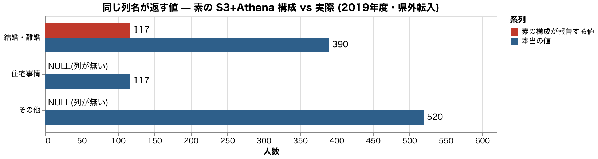

<!-- _class: title -->
<!-- _paginate: false -->

# CSV置くだけ構成は壊れずに間違う

## 秋田のオープンデータで検証するS3 Tables

JAWS-UGビッグデータ支部 織田 繁

<!--
-->

---

# 自己紹介

## Shigeru Oda

- Sansan株式会社 技術本部
  - Sansan Engineering Unit Infrastructure Group
  - Data Intelligence Engineering Unit Infrastructure Group

- Community
  - AWS Community Hero
  - JAWS-UG ビッグデータ支部 運営
  - JAWS-UG 初心者支部 運営

<!--
-->

---

# 秋田県オープンデータカタログサイト


https://opendata.pref.akita.lg.jp/

<!--
-->

---

# 利用できるデータセット

<style scoped>
table { font-size: 0.80em; }
</style>

17分野・264データセット、詳細なデータセットについては後述する付録を参照

| 分野                      |  件 | 例                                               |
| ------------------------- | --: | ------------------------------------------------ |
| 行財政                    |  53 | 市町村決算、県民意識調査、市町村コード一覧       |
| 教育・文化・生活          |  39 | 小中高・特別支援学校一覧、放課後児童クラブ       |
| 労働・賃金                |  30 | 毎月勤労統計、Ａターン就職者統計                 |
| 人口・世帯                |  24 | 年齢別人口流動調査（月報・年報）、人口移動理由   |
| 司法・安全・環境          |  18 | 交通事故発生状況、特殊詐欺被害、海岸漂着ごみ     |
| 社会保障・衛生            |  15 | 病院名簿、病床機能報告、保護状況                 |
| エネルギー・水／国土・気象 |  21 | 風力・地熱・メガソーラー、指定避難所、津波想定   |
| ほか9分野 ＋ 分野なし     |  64 | 工業団地情報、クマダス（クマ目撃）、在住外国人数 |

<!--
-->

---

# 月報人口からみる秋田

|        |                                                         |
| ------ | ------------------------------------------------------- |
| 人口   | 878,798人（2025年10月）                                 |
| ピーク | 1981年 1,257,411人 → 30.1% 減                           |
| 直近   | 864,753人（2026年7月）                                  |
| 年齢   | 65歳以上 40.1% ／ 75歳以上 201,669人 ／ 15歳未満 8.6%   |
| 減り方 | 自然減 13,803人 ／ 社会減 3,434人 → 減少の 80% は自然減 |

この4つを県のCSVから出す

<!--
S2 / 66秒
人口は1980年の1,256,745人から2025年の878,798人へ、30.1パーセント減りました。
ピークは1981年の1,257,411人で、直近の月報では864,753人です。
65歳以上が40.1パーセント、75歳以上が201,669人、15歳未満は8.6パーセント。
2025年は自然増減が13,803人の減、社会増減が3,434人の減で、減少の80パーセントは自然減でした。
この4つの数字を、県が公開しているCSVから出します。
-->

---

# 素朴な構成で出す

|        | 素の S3 + Athena     | S3 Tables                  |
| ------ | -------------------- | -------------------------- |
| 置き方 | CSVをそのまま置く    | テーブルバケットに取り込む |
| 定義   | Glueにテーブルを作る | Icebergのスキーマ          |
| 費用   | スキャンした分だけ   | ストレージ + 監視 + 圧縮   |
| 手間   | 数分                 | 取り込み直しが必要         |

数メガバイトの自治体データ。Icebergが必要な規模ではない

<!--
S3 / 31秒
やり方は一番手軽なものを選びます。CSVをS3に置いて、Glueにテーブルを定義して、
Athenaから SELECT する。数分でできて、費用もスキャンした分だけです。
扱うのは数メガバイトの自治体データで、Icebergが必要な規模ではありません。
それでもこの構成を離れる理由がありました。
-->

---

# カタログの実像: CSV は少数派

264 データセット ／ 2,261 リソース ／ 11 形式（CKAN、2026-10-04 取得）

|                      | データセット数 |
| -------------------- | -------------: |
| CSV を持つ           |            114 |
| Excel を持つ         |            187 |
| うち CSV が1本もない |            138 |
| 分野が付いていない   |             24 |

CSVは少数派。半分以上は S3 に置く前に変換が必要

<!--
S4 / 45秒
秋田県のカタログはCKANで、データセットが264件、リソースが2,261本あります。
最初のつまずきはここでした。CSVは少数派です。
CSVを持つデータセットは114件に対して、Excelを持つのは187件。
うち138件はCSVが1本もなく、Athenaで読む前に変換が必要です。
分野が付いていないデータセットも24件あって、新しい公表分から落ちています。
分野で絞って集めると最新年次を取りこぼします。
-->

---

# 題材: 月報人口CSV

```
pref_jinkousetai_2020.csv   36列 / 408行
pref_jinkousetai_2024.csv   36列 / 408行
pref_jinkousetai_2025.csv   36列
pref_jinkousetai_2026.csv   36列
```

市町村別の人口・出生死亡・転入転出。年度ごとに1ファイル

やりたいこと: 年度をまとめて1つのテーブルとして読む

<!--
S5 / 27秒
4つの数字のうち、人口と増減の3つは月報人口CSVから出します。
市町村別の人口・出生死亡・転入転出が入った36列のファイルで、年度ごとに公開されています。
やりたいことは、年度ごとのファイルをまとめて1つのテーブルとして読むこと。ごく普通の要求です。
-->

---

# 第1段: 2024年に26列の名前が変わった

36列 → 36列。26列が改称。挿入・削除・並べ替えは 0 件

| 位置 | 2020年版               | 2024年版           |
| ---- | ---------------------- | ------------------ |
| 20   | 県外転入・男女計（人） | 転入・合計（人）   |
| 23   | 県内転入・男女計（人） | 転入・県内計（人） |
| 24   | 転入・県外計（人）     | 転入・県外計（人） |

並び順は36列すべて同一。変わったのはラベルだけ

<!--
S6 / 42秒
このファイルは2024年版で36列のうち26列の列名が変わりました。
大事なのは、変わったのが名前だけということです。
36列を位置ごとに突き合わせると並び順は完全に同一で、列の挿入も削除も並べ替えも1件もありません。
位置20を見てください。2020年版では「県外転入・男女計」でしたが、2024年版では「転入・合計」です。
位置24の「転入・県外計」は両方とも同じ名前で残っています。
-->

---

# 「県外転入」は県外転入ではなかった

位置20 ＝ 位置23（県内）＋ 位置24（県外）。396行すべて一致

| 2020年版 | 県外だと信じた値 | 実際の県外 |     過大 |
| -------- | ---------------: | ---------: | -------: |
| 市部計   |          1,125人 |      639人 |      76% |
| 郡部計   |            104人 |       45人 |     131% |
| 県計     |         11,711人 |   11,711人 | 一致する |

県計では県内が空欄なので検算が通る。市町村別に落とした瞬間に間違う

<!--
S7 / 90秒
気づいてほしいのは、2020年版には県外を指す列が2つあったことです。
検算すると、位置20の値は位置23の県内と位置24の県外の合計でした。396行すべて一致します。
つまり「県外転入」という名前の列に県内と県外の合計が入っていた。
2024年の「転入・合計」への改称は、県による名前の訂正だったわけです。
この列を県外転入だと信じて集計すると、市部計で1,125人、実際の県外は639人。76パーセントの過大です。
郡部計は104人に対して45人で、131パーセント過大。
母数が小さいほど県内移動の比率が高いので、市町村別に落とすほど誤差が広がります。
ここが意地悪なところで、県計だけ見ていると一致します。
県全体では県内移動が打ち消し合うので県内転入の欄が空になり、合計と県外が同じ値になる。
県の集計を見て検算したつもりになって、市町村別に落とした瞬間に間違い始めます。
-->

---

# なぜ気づけないのか

2020年版の定義で両方を読む → 816行・エラー0・警告0

| 気づけない理由           | 中身                                                                     |
| ------------------------ | ------------------------------------------------------------------------ |
| ヘッダがクエリに入らない | `skip.header.line.count=1` で1行目を捨てる。列名は処理系に一度も渡らない |
| 検出可能な差分がない     | 位置・値の意味・行数・型がすべて同じ                                     |

実機Athenaでも `information_schema` は旧名のまま（2026-08-13 確認）

<!--
S8 / 62秒
ではAthenaはこの訂正を教えてくれるのか。教えてくれません。
2020年版の定義で両方のファイルを読んでも、816行、エラーも警告もゼロで通ります。
理由は2つあります。1つ目、ヘッダ行はクエリに入っていません。
CSVテーブルは skip.header.line.count で1行目を捨てるので、列名は処理系に一度も渡りません。
県が訂正を1行目に書いても、その行は捨てられます。
2つ目、検出可能な差分が存在しません。位置も値の意味も行数も型も同じです。
Athenaが気づかないのではなく、気づく材料が届いていない。構造上そうなります。
-->

---

# 列が消えると値がずれる

人口移動理由実態調査。2019年に分類が再編され 19列 → 16列



7項目が別の項目の値を返し、3項目がNULL。検算は1,521行すべて一致する

<!--
S9 / 73秒
名前が変わるだけなら値は壊れませんでした。列が消えるとずれます。
4つ目の数字、移動の理由を出すために人口移動理由実態調査を使います。
2019年に分類が再編されて、19列が16列になりました。統合と分割と削除が同時です。
旧定義のまま読むと、結婚・離婚が理由の人数は117人と返ります。
正しい値は390人で、117は住宅事情の人数です。
この1行だけで7項目が別の項目の数字を返し、3項目がNULLになります。
存在しない「家業後継」にも295が入り、中身は学業です。
ここが要点で、このデータには総数の列があるので検算できます。
やってみると1,521行すべて一致します。ラベルだけが入れ替わっているので足せば合う。
品質チェックをすり抜けます。
-->

---

# S3 Tables に入れる

汎用バケットとは別種のテーブルバケット。Athena の CTAS で取り込み直す

|          | 素の CSV   | Iceberg                |
| -------- | ---------- | ---------------------- |
| 列の同定 | 位置       | field ID               |
| 改称     | 気づけない | スキーマ進化として記録 |
| 列の増減 | 値がずれる | 別の列として足される   |

旧版 19列 + 新版 → 28列。旧版の行は追加された9項目がNULLになる

<!--
S10 / 64秒
S3 Tablesは汎用バケットとは別種のテーブルバケットを作ります。
CSVをそのまま置くのではなく取り込み直しで、AthenaのCTASで書き出します。
元のCSVを残すなら二重保管になります。
Icebergは列を位置ではなく field ID で管理します。
名前が変わってもIDは変わらないので、リネームはスキーマ進化として記録される。
名前が違う列は別の列として足されるので、値が別の項目に流れ込みません。
旧版のテーブルに新版を足すと、列は19から28に増えます。
【要実測】CTASのSQLと所要時間、つまずいた権限エラーをここに1枚
-->

---

# 同じ集計をもう一度

冒頭の4つの数字を S3 Tables の上で出し直す

|                  | 素の S3 + Athena     | S3 Tables       |
| ---------------- | -------------------- | --------------- |
| 列名が変わった年 | 静かに間違う         | 同じSQLで取れる |
| 分類が変わった年 | 値がずれる           | 同じSQLで取れる |
| 再編前に戻る     | 自分でフォルダを切る | snapshot        |

回答総数は2019年に 4,481人 → 6,413人（43.1%増）。比較の可否は統計側の判断

<!--
S11 / 66秒
冒頭の4つの数字に戻ります。S3 Tablesの上で同じ集計をすると、数字が合います。
列名が変わった年も、分類が変わった年も、同じ1本のSQLで取れます。
追記のたびにスナップショットが記録されるので、再編前の状態にも戻れます。
置くだけ構成なら年度ごとのフォルダを自分で切ることになります。
ただ、正直に言うと2019年に段差が出ます。回答総数そのものが4,481人から6,413人へ、
43.1パーセント増えていました。調査の規模か方法も変わったわけです。
Icebergが保証するのは壊れずに1つのテーブルで読めるところまで。
比較していいかどうかは統計側の判断で、自動化できません。
-->

---

<!-- _class: plain -->

# 「マネージド」の中身

```hcl
iceberg_compaction                = { status = "enabled", target_file_size_mb = 64 }
iceberg_snapshot_management       = { max_snapshot_age_hours = 168, min_snapshots_to_keep = 5 }
iceberg_unreferenced_file_removal = { unreferenced_days = 3, non_current_days = 1 }
```

コンパクションとスナップショット管理はテーブル単位、未参照ファイルの削除はバケット単位

私のデータではコンパクションの出番がなかった（ファイル2個・数十キロバイト）

<!--
S12 / 48秒
「マネージド」の中身はこの3つです。小さいファイルをまとめるコンパクション、
古いスナップショットの期限切れ処理、参照されなくなったファイルの削除。
設定の粒度が分かれているのが実務上のポイントです。
コンパクションとスナップショット管理はテーブル単位、
未参照ファイルの削除はバケット単位でしか設定できません。
【要実測】コンパクションが実際に走ったか、snapshot が期限切れで消えたか
私のデータではコンパクションの出番がありませんでした。
-->

---

# パフォーマンス実測

| ローカル実測  |   サイズ | 全件スキャン |
| ------------- | -------: | -----------: |
| CSV 2ファイル | 143.5 KB |       0.9 ms |
| Iceberg       |  39.0 KB |       3.5 ms |

実機Athenaのスキャン量は1クエリ 129,354 / 146,928 bytes（2ファイル全体）

Athenaの課金は1クエリ最小10MB。この規模では最小課金が支配する

<!--
S13 / 77秒
S3 Tablesは汎用バケット上のIcebergよりクエリ最大3倍と謳われますが、
それはコンパクションで小さいファイルがまとまり、メタデータで読む範囲を絞れる規模の話です。
手元で測ると、この規模ではCSVを直接読むほうが速い。
143.5キロバイトのCSVが0.9ミリ秒、39.0キロバイトのIcebergが3.5ミリ秒です。
ミリ秒の桁なので実行ごとにぶれますが、4倍前後の差は毎回同じ向きに出ます。
【要実測】実機 Athena での素の構成 vs S3 Tables の実行時間とスキャン量
速さのためにS3 Tablesを選ぶ理由は、この規模にはありません。
-->

---

# 判断軸はデータ量ではない

| 自分のデータが…      | 素の S3+Athena         | S3 に Parquet | S3 Tables              |
| -------------------- | ---------------------- | ------------- | ---------------------- |
| 列の構成が変わらない | 十分                   | ◎             | 過剰                   |
| 列名が変わる         | 気づけない             | 名前で読む    | 進化として記録         |
| 列が増減する         | 値がずれる             | ○             | ◎                      |
| 過去の版を遡りたい   | 自分で運用             | 自分で運用    | snapshot               |
| 同時書き込み         | 中途半端な状態が見える | 同じ          | アトミック             |
| 数MB程度             | 安くて速い             | ◎             | 監視・圧縮の費用が乗る |

年に一度スキーマが動くデータなら、置くだけ構成は危険

<!--
S14 / 55秒
まとめます。判断の軸はデータ量ではなく、スキーマが動くかどうかでした。
列の構成が安定していてサイズも小さいなら、素のS3とAthenaで十分です。安くて速い。
私のデータも、速度だけ見ればそちらが有利でした。
逆に、年に一度スキーマが動くデータなら置くだけ構成は危険です。
名前が変わっても気づけず、列が増減すれば値がずれ、検算はすり抜けます。
Parquetでもリネームには強くなりますが、過去の版に戻る仕組みと
同時書き込みのアトミック性は付いてきません。そこが要るならS3 Tablesです。
-->

---

# 秋田のデータが言っていること

2025年度・県外転出 4,705人の理由

|            |  転出 |  転入 |
| ---------- | ----: | ----: |
| 転職・就職 |   27% |   23% |
| 退職・同居 | 242人 | 776人 |

出ていくのは仕事で、戻ってくるのは暮らし

<!--
S15 / 62秒
最後に、正しく取れた数字が言っていることを一つだけ。
2025年度に県外へ転出した4,705人の理由は、1位が転職・就職で27パーセント。
逆向きでは、県外から入ってくる側に退職・同居が776人います。転出側の同じ理由は242人。
出ていくのは仕事で、戻ってくるのは暮らし。秋田に戻る人は確かにいます。
検証は全部コードで残してあります。中身は普通の.pyです。
秋田のデータは扱いにくく、列名も途中で変わります。
でもその変更は、間違った名前を県が直したものでした。
直したことが伝わらない仕組みを使っていたのは、私の側です。
ありがとうございました。
-->

---

<!-- _class: section light -->

# 予備: Q&A の材料

<!--
ここから先は質疑用。通しでは出さない。
-->

---

# Q&A の材料

| 想定質問                    | 答えの材料                                                                           |
| --------------------------- | ------------------------------------------------------------------------------------ |
| Parquetでは?                | 名前で読むのでリネームも増減も可。過去の版と同時書き込みのアトミック性は付いてこない |
| Glue Crawlerを再実行すれば? | 列名は更新されるので気づける。ただし位置がずれる変更では再クロールが逆に壊す         |
| 県計では一致するのでは?     | 一致する。だから県計で検算すると通ってしまう                                         |
| DuckDBで代替できる?         | 列数不一致をエラーにする。共有・権限・同時書き込みが要るならS3側                     |
| コンパクションで速くなる?   | 私のデータでは出番がなかった（ファイル2個）。GB級で試すべき                          |

---

<!-- _class: plain -->

# 出典と検証コード

この資料は以下の著作物を改変して利用しています。「年齢別人口流動調査」「人口移動理由実態調査」（秋田県）[秋田県オープンデータカタログサイト](https://opendata.pref.akita.lg.jp/)、[クリエイティブ・コモンズ・ライセンス 表示 4.0](https://creativecommons.org/licenses/by/4.0/legalcode.ja)

他県比較: 39都道府県を調査。19ファイル中11がShift_JIS、ヘッダが1行目にない県が4件（長崎8行目・徳島5行目・佐賀3行目・北海道2行目）

検証コードとデータ台帳: github.com/shigeru-oda/jaws-festa-2026

<!--
リポジトリは当日までにpublicにする（アブストで「手元で動かせる検証コードを持ち帰れます」と約束している）。
-->

---

<!-- _class: section light -->

# 付録: 収録データセット全件

264データセット / 201系列 / 2026-10-04 取得

<!--
ここから先は当日は飛ばす。公開後に読む人のための全件リスト。
年次違い・市町村違いは1系列にまとめて xN で件数を示している。
分野ごとの件数を足すと266になるが、2分野に属するデータセットが2件あるため
（令和4年秋田県衛生統計年鑑、都市計画基礎調査（男鹿市））。実数は264。
-->

---

# 付録: 記号の意味

| 記号      | 意味                                                      |
| --------- | --------------------------------------------------------- |
| （なし）  | CSV 配布あり。S3 に置いて Athena / S3 Tables でそのまま読める |
| [Excel]   | CSV 配布がなく XLS/XLSX のみ。取り込み前に変換が必要      |
| [Word]    | DOC/DOCX を含む。表ではなく報告書の本文                   |
| [Geo]     | GeoJSON を含む。264件中2件だけ                            |
| [ZIP]     | ZIP でまとめ配布。中身は Excel 一式・CSV 一式・GIS など   |
| [API]     | CSV に加えて JSON/RDF/XML を揃えている                    |
| xN        | 同じ表の年次違いが N 件                                   |

---

# 付録: 人口・世帯（24件 / 24系列）

<style scoped>
ul { column-count: 2; column-gap: 28px; font-size: 0.62em; line-height: 1.6; margin-top: 10px; }
li { break-inside: avoid; }
</style>

- 年齢別人口流動調査（月報）[API]
- 年齢別人口流動調査（月報バックナンバー）[API]
- 年齢別人口流動調査（年報：2025年 秋田県の人口）
- 年齢別人口流動調査（年報時系列データ）[API]
- 年齢別人口流動調査（県・市町村の年齢各歳、男女別人口）
- 人口移動理由実態調査（2025年度 調査報告書）[Excel]
- 人口移動理由実態調査（時系列データ：2013年以降）[API]
- 住民基本台帳人口
- 国勢調査 [Excel][Word]
- 市町村別人口（4月現在）[Excel][Geo]
- 秋田県衛生統計年鑑 [Excel][Word]
- 自殺者数の状況 [Excel]
- 都市計画基礎調査 x12（秋田市・大仙市・由利本荘市・北秋田市・仙北市・鹿角市・潟上市・男鹿市・にかほ市・美郷町・五城目町・小坂町）

---

# 付録: 教育・文化・スポーツ・生活（39件 / 30系列）

<style scoped>
ul { column-count: 2; column-gap: 28px; font-size: 0.62em; line-height: 1.55; margin-top: 10px; }
li { break-inside: avoid; }
</style>

- 子ども・若者行政関係資料 x5
- 子ども・若者を取り巻く状況 x4
- 第２次あきた子ども・若者プランに基づく施策の実施状況 x2
- 第３次あきた子ども・若者プランに基づく施策の実施状況 x2
- 第２次・第３次あきた子ども・若者プランに基づく施策の実施状況
- 子ども・若者支援機関一覧
- 学校一覧 x5（小学校・中学校・高等学校・特別支援学校・義務教育学校）
- 幼稚園・保育所・認定こども園一覧
- 地域型保育実施施設一覧
- 認可外保育施設一覧
- 放課後児童クラブ一覧
- 新・放課後子ども総合プラン実施箇所一覧
- あきた子育てふれあいカード協賛店一覧 [API]
- 教育委員会一覧
- 社会教育施設一覧（生涯学習・社会教育関係）
- 社会教育施設一覧（文化・芸術関係）
- 確認大学等一覧（高等教育の修学支援新制度）
- 私立専修学校・各種学校一覧 [Excel]
- 秋田県立衛生看護学院 入学・就職状況 [Excel]
- 学校基本調査結果 [Excel]
- 学校保健統計調査結果 [Excel]
- 社会生活基本調査 [Excel]
- スポーツ実態調査
- 総合型地域スポーツクラブ設置数
- 生活衛生課業務概要 [Excel]
- 宗教法人名簿

---

# 付録: 行財政（53件 / 30系列）

<style scoped>
ul { column-count: 2; column-gap: 28px; font-size: 0.62em; line-height: 1.55; margin-top: 10px; }
li { break-inside: avoid; }
</style>

- 決算概況 [Excel][Word] x8
- 財務書類 [Excel] x8
- 県民意識調査 [ZIP] x5
- 税務統計書 x4
- 秋田市消費者物価指数（月報）[Excel] x3
- 秋田市消費者物価指数（年報）[Excel]
- 秋田市消費者物価指数（グラフ）[Excel]
- 秋田県税務統計書
- 秋田県財務規則 [Word]
- 不服申立ての処理状況 [Excel]
- 免許人口 [Excel]
- 固定資産の価格等の概要調書 [Excel]
- 固定資産の提示平均価額 [Excel]
- 地方公営企業の抜本的な改革等の取組状況 [Excel]
- 審議会等一覧
- 市町村公営企業概要 [Excel]
- 市町村公営企業経営比較分析表 [Word][ZIP]
- 市町村別市町村税の税率一覧 [Excel]
- 市町村所在地・コード一覧
- 市町村決算（普通会計）の状況 [Excel]
- 市町村特別職（市町村長・議長等）一覧
- 市町村税の徴収実績 [Excel]
- 市町村税の課税状況等 [Excel]
- 市町村財政の健全化の状況 [Excel]
- 市町村財政指標 [Excel]
- 指定管理者制度の導入状況
- 県内市町村のラスパイレス指数 [Excel]
- 県内市町村職員数
- 知事所管公益法人等一覧
- 行政手続のオンライン化の状況 [Excel]

---

# 付録: 社会保障・衛生（15件）／ 労働・賃金（30件）

<style scoped>
ul { column-count: 2; column-gap: 28px; font-size: 0.62em; line-height: 1.55; margin-top: 10px; }
li { break-inside: avoid; }
h3 { font-size: 0.62em; margin: 0 0 4px; }
</style>

- 社会保障・衛生: 病床機能報告における病床の状況 [Excel] x5
- 社会保障・衛生: 病院名簿 [Excel]
- 社会保障・衛生: 特定健診・後期高齢者健診 実施医療機関一覧表 [Excel]
- 社会保障・衛生: 市町村別国保税一覧 [Excel]
- 社会保障・衛生: 障害者等用駐車区画利用制度協力施設一覧 [Excel]
- 社会保障・衛生: 社会福祉施設・法人便覧 [Word][ZIP]
- 社会保障・衛生: 福祉事務所一覧 [Word]
- 社会保障・衛生: 秋田県内の救急医療体制 [Word]
- 社会保障・衛生: 秋田県衛生統計年鑑 [Excel][Word]
- 社会保障・衛生: 新型コロナウィルス感染状況関連データ
- 社会保障・衛生: 保護状況
- 労働・賃金: 労働条件等実態調査その１〜その５ [Excel] x19
- 労働・賃金: 毎月勤労統計調査地方調査結果（月報）[Excel] x5
- 労働・賃金: 毎月勤労統計調査地方調査結果（年報）[Excel]
- 労働・賃金: 出稼労働者推計調査結果 [Excel] x2
- 労働・賃金: Ａターン就職者に関する統計情報 [Excel]
- 労働・賃金: 秋田県の労働組合組織状況 [Excel]
- 労働・賃金: 県内の地域おこし協力隊活動状況 [Excel]

---

# 付録: 司法・安全・環境（18件）／ 国土・気象（10件）

<style scoped>
ul { column-count: 2; column-gap: 28px; font-size: 0.62em; line-height: 1.55; margin-top: 10px; }
li { break-inside: avoid; }
</style>

- 司法: 犯罪統計資料 [Excel]
- 司法: 交通事故発生状況 [Excel]
- 司法: 特殊詐欺被害認知状況 [Excel]
- 司法: SNS型投資・ロマンス詐欺被害認知状況 [Excel]
- 司法: 警察安全相談受理状況
- 司法: 遺失物・拾得物件・遺失者返還の取扱状況について
- 司法: 航空隊ヘリ出動状況
- 環境: 海岸漂着ごみ組成調査結果 [Excel] x5
- 環境: 河川ごみ組成調査結果 [Excel] x2
- 環境: 河川ごみ組成調査 [Excel]
- 環境: 温室効果ガス排出量 [Excel]
- 環境: 廃棄物処理法違反検挙状況
- 環境: 建築物における衛生的環境の確保に関する登録事業者一覧
- 国土: 地震被害想定データ（震度分布図・液状化危険度分布図）その１〜３ [ZIP] x3
- 国土: 地震被害想定データ（被害想定結果）その１〜３ [Word] x3
- 国土: 津波浸水想定データ [ZIP]
- 国土: 指定避難所・指定緊急避難場所 [Excel]
- 国土: 都市計画に関するデータ [API]
- 国土: 降積雪データ [Excel]

---

# 付録: エネルギー・水（11件）／ 企業・家計・経済（9件）

<style scoped>
ul { column-count: 2; column-gap: 28px; font-size: 0.62em; line-height: 1.6; margin-top: 10px; }
li { break-inside: avoid; }
</style>

- エネルギー: 風力発電の導入状況
- エネルギー: 水力発電の導入状況
- エネルギー: 地熱発電の導入状況
- エネルギー: バイオマス発電の導入状況
- エネルギー: メガソーラーの導入状況
- エネルギー: 県営水力発電所一覧
- エネルギー: 県営水力発電所発電電力量
- 水: 給水事業所一覧
- 水: 実績給水量及び料金収入
- 水: 工業用水道施設の概要
- 水: 汚水処理人口普及率 [Excel]
- 経済: 県民経済計算 [Excel]
- 経済: 市町村民経済計算 [Excel]
- 経済: 秋田県産業連関表 [Excel]
- 経済: 経済センサス－活動調査集計結果（秋田県の概要）[Excel]
- 経済: 景気動向指数 [Excel]
- 経済: 県内経済動向調査 [ZIP]
- 経済: 秋田市消費者物価指数（月報）[Excel]
- 経済: 建築着工統計調査（グラフ）[Excel]
- 経済: 東北地域百貨店・スーパー販売額動向（グラフ）[Excel]

---

# 付録: 農林水産・鉱工業・商業・運輸・住宅土地（20件）

<style scoped>
ul { column-count: 2; column-gap: 28px; font-size: 0.62em; line-height: 1.6; margin-top: 10px; }
li { break-inside: avoid; }
</style>

- 農林水産: 秋田県農林水産業累年統計表 [ZIP]
- 農林水産: 農林業センサス農林業経営体調査 [Excel][Word]
- 農林水産: 農林業センサス農林業経営体調査結果 [Excel][Word]
- 農林水産: ２０１８年漁業センサス漁業経営体調査 [Excel]
- 農林水産: 認定農業者の認定状況 [Excel]
- 農林水産: 森林情報公開サービス
- 鉱工業: 鉱工業生産指数 [Excel]
- 鉱工業: 秋田県の工業 [Excel]
- 商業: 商業統計調査 [Excel]
- 商業: 旅館業許可施設一覧
- 商業: 集中調達物品契約状況 [Excel]
- 運輸観光: 秋田県観光統計 [Excel]
- 運輸観光: 秋田空港利用者数（グラフ）[Excel]
- 運輸観光: 港湾取扱貨物量（グラフ）[Excel]
- 運輸観光: 乗合バス・第三セクター鉄道輸送人員 [Excel]
- 運輸観光: 交通量調査結果
- 運輸観光: 秋田のみちの現状
- 住宅土地: 住宅・土地統計調査 [Excel][Word]
- 住宅土地: 建築着工統計調査結果 [API]
- 住宅土地: 屋外広告業登録業者一覧 [API]

---

# 付録: 国際・情報通信・その他（13件 / 10系列）

<style scoped>
ul { font-size: 0.62em; line-height: 1.75; margin-top: 14px; }
</style>

- 国際: 秋田県の貿易（統計版）x4
- 国際: 在住外国人数
- 情報通信: オープンデータ一覧
- 情報通信: 県提供公衆Wi-Fiアクセスポイント一覧
- その他: ツキノワグマ等情報マップシステム『クマダス』データ [API]
- その他: 工業団地情報
- その他: 都市計画基礎調査（男鹿市）
- その他: 児童相談所業務概要に係る相談の受付及び処理状況 [Excel]
- その他: 秋田県認証 NPO法人一覧 [Excel]
- その他: 秋田県知事における認定（特例認定）法人一覧 [Excel]

---

# 付録: 分野が付いていない24件（22系列）

<style scoped>
ul { column-count: 2; column-gap: 28px; font-size: 0.62em; line-height: 1.6; margin-top: 10px; }
li { break-inside: avoid; }
</style>

- 労働条件等実態調査その１〜その５ [Excel] x5
- 子ども・若者を取り巻く状況 x2
- 県民意識調査 [ZIP] x2
- 子ども・若者行政関係資料
- 第３次あきた子ども・若者プランに基づく施策の実施状況
- 幼稚園・保育所・認定こども園一覧
- 毎月勤労統計調査地方調査結果（月報）[Excel]
- 出稼労働者数推計調査結果 [Excel]
- 秋田市消費者物価指数（月報）[Excel]
- 秋田県産業連関表 [Excel]
- 秋田県の貿易（統計）
- 財務書類 [Excel]
- 海岸漂着ごみ組成調査結果 [Excel]
- ２０２３年漁業センサス漁業経営体調査 [Excel]
- 都市計画基礎調査 x2（大館市・八郎潟町）
- 県の公共施設等の見える化 [Geo]
- アオコ発生状況

<!--
純粋な新規系列は「県の公共施設等の見える化」と「アオコ発生状況」の2件だけ。
残り20件は、同じ調査の別年次・別市町村版が分野付きで存在する。
metadata_modified の年で未設定率が上がる: 2023年 0/107、2024年 5/51、2025年 7/46、2026年 12/60。
新しい公表分ほど分野が付いていない。分野で絞るスクリプトは最新年次を静かに落とす。
-->
