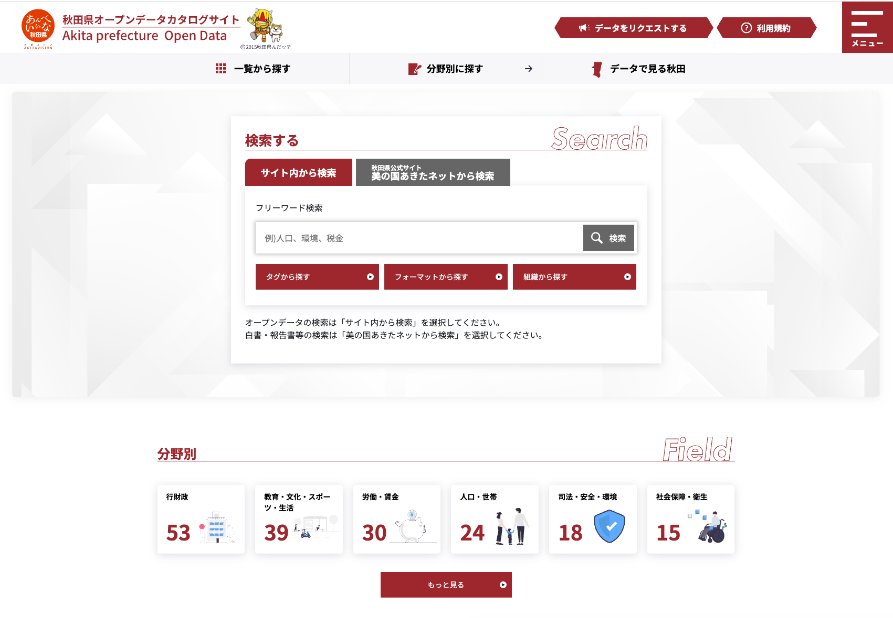
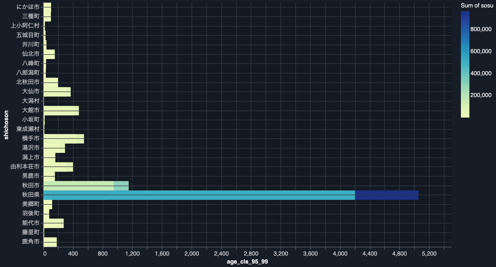
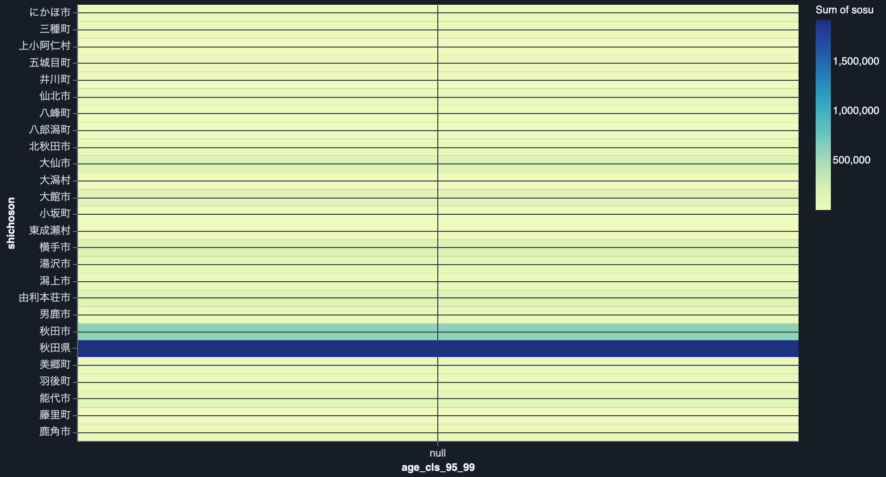
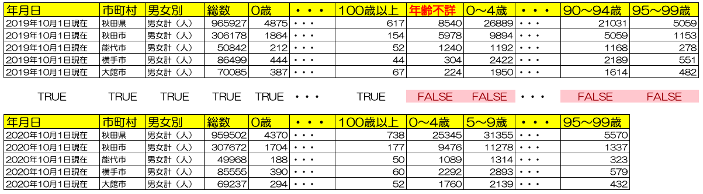

<!-- _class: title -->
<!-- _paginate: false -->

# CSV置くだけ構成は壊れずに間違う

## 秋田のオープンデータで検証するS3 Tables

### JAWS-UGビッグデータ支部 織田 繁

<!--
-->

---

## 自己紹介

### Shigeru Oda

- Community
  - AWS Community Hero
  - JAWS-UG ビッグデータ支部 運営
  - JAWS-UG 初心者支部 運営

- Sansan株式会社 技術本部
  - Sansan Engineering Unit Infrastructure Group
  - Data Intelligence Engineering Unit Infrastructure Group

<!--
-->

---

## 秋田県オープンデータカタログサイト

<!--
-->

---

## 利用できるデータセット

17分野・264データセット、詳細なデータセットについては後述する付録を参照

| 分野                       |  件 | 例                                               |
| -------------------------- | --: | ------------------------------------------------ |
| 行財政                     |  53 | 市町村決算、県民意識調査、市町村コード一覧       |
| 教育・文化・生活           |  39 | 小中高・特別支援学校一覧、放課後児童クラブ       |
| 労働・賃金                 |  30 | 毎月勤労統計、Ａターン就職者統計                 |
| 人口・世帯                 |  24 | 年齢別人口流動調査（月報・年報）、人口移動理由   |
| 司法・安全・環境           |  18 | 交通事故発生状況、特殊詐欺被害、海岸漂着ごみ     |
| 社会保障・衛生             |  15 | 病院名簿、病床機能報告、保護状況                 |
| エネルギー・水／国土・気象 |  21 | 風力・地熱・メガソーラー、指定避難所、津波想定   |
| ほか9分野 ＋ 分野なし      |  66 | 工業団地情報、クマダス（クマ目撃）、在住外国人数 |

<!--
-->

---

## データセットのチェックの仕方

外部から手に入れたデータセットでのチェックの仕方を一例としてお伝えします。
`県・市町村の年齢各歳、男女別人口`というデータセットを利用しています。

| 項目     | 内容                                                                                  |
| -------- | ------------------------------------------------------------------------------------- |
| 期間     | 1980〜2025年                                                                          |
| ファイル | 5年ごとに1本、計9本のCSV（UTF-8 BOM付き）                                             |
| 地域     | 秋田県計 ＋ 市町村                                                                    |
| 行       | 年 × 地域 × 男女別（男女計・男・女）                                                  |
| 列       | 年月日コード・年月日・市町村コード・市町村・男女別・総数・0〜100歳以上の各歳・5歳階級 |

---

## Sampleデータ

`pref_nenreikakusai_2020.csv` の1行（2025年・秋田県・男女計）

| カラム          |                値 |
| --------------- | ----------------: |
| 年月日コード    |        2025001001 |
| 年月日          | 2025年10月1日現在 |
| 市町村コード    |              5000 |
| 市町村          |            秋田県 |
| 男女別          |      男女計（人） |
| 総数            |           878,798 |
| 0歳(1歳刻み)    |             3,068 |
| 0～4歳(5歳刻み) |            18,782 |

---

## データセットのチェックの仕方 構成図

---

## データセットのチェックの仕方 Landing層

方針

- 文字コード・改行コード・構造だけをそろえること
- 型とデータの中身は見ない（Bronze / Silver で扱う）

チェック内容

- 文字コードがUTF-8であるか または 変換可能であること
- 改行コードはLFであるか または 変換可能であること
- 構造化データ または 半構造化データでTable変換可能であること
- "で囲みがないこと(","などのエスケープされたカンマがあることを危惧)
- 列数がヘッダとデータで差異はないこと
- 空行がないこと

---

## データセットのチェックの仕方 Bronze層

方針

- 元データの内容を型変換などせず素直に取り込むこと
- 全カラムString型とすること
- 単項目・簡単な相関チェックを実施すること

チェック内容

- CSVファイルとTable件数が同じであること
- 数値型となる想定の列は数値変換が可能であること
- 合算の計算があうこと
- キー重複がないこと
- 男女計・男・女が1行ずつあるか

---

## データセットのチェックの仕方 Silver層

方針

- Bronze の String に型を付けること（人数の列は long）
- 数値にならない`-`は NULL にすること（0 にはしない）
- マイナスの値は推計値としてそのまま残し、件数を記録すること
- 可視化でのチェックを行うこと

チェック内容

- Bronze層と件数が同じであること
- 5歳階級の推移を可視化
- 人口ピラミッドを可視化
- '-'とマイナスの分布を可視化
- 総数の推移を可視化
- 数値カラムごとのNULLとマイナスを可視化
- 年 × 各歳のヒートマップ可視化

---

## 2019年のデータ 95～99歳

<!--
-->

---

## 2020年のデータ 95～99歳 -> 全データがNull

<!--
-->

---

## 年齢不詳カラムが消えていた

---

## Amazon AthenaはCSVのヘッダ名を確認していない

| 予想されるスキーマ更新のタイプ         | CSV / TSV (ヘッダー有無とも) | JSON | AVRO | PARQUET 名前で読む (既定) | PARQUET インデックス で読む | ORC インデックス で読む(既定) | ORC 名前で読む |
| -------------------------------------- | :-----------------------------: | :--: | :--: | :-----------------------------: | :-------------------------------: | :---------------------------------: | :---------------: |
| 列の名前変更                           |                Y                |  N   |  N   |                N                |                 Y                 |                  Y                  |         N         |
| テーブルの先頭または中間に列を追加する |                N                |  Y   |  Y   |                Y                |                 N                 |                  N                  |         Y         |
| テーブルの末尾に列を追加する           |                Y                |  Y   |  Y   |                Y                |                 Y                 |                  Y                  |         Y         |
| 列の削除                               |                N                |  Y   |  Y   |                Y                |                 N                 |                  N                  |         Y         |
| 列の順序変更                           |                N                |  Y   |  Y   |                Y                |                 N                 |                  N                  |         Y         |
| 列のデータ型の変更                     |                Y                |  Y   |  Y   |                Y                |                 Y                 |                  Y                  |         Y         |

- Y = その形式はこのスキーマ変更に対応している（クエリを変えずに読み続けられる）
- N = 対応していない（CSV は位置で読むのでエラーにならず、値がずれたまま返る）

出典: Amazon Athena ユーザーガイド「スキーマの更新を処理する」の表「Athena におけるスキーマ更新とデータ形式」

---

## 【参考】DuckDBの場合

| 更新タイプ               | CSV 既定 | CSV union_by_name | CSV 位置指定 | Parquet 既定 | Parquet union_by_name | JSON union_by_name | AVRO (avro拡張) |
| ------------------------ | :---------: | :------------------: | :-------------: | :-------------: | :----------------------: | :-------------------: | :----------------: |
| 列の名前変更             |   エラー    |         NULL         |        ○        |     エラー      |           NULL           |         NULL          |       エラー       |
| 先頭または中間に列を追加 |      ○      |          ○           |      ズレ       |        ○        |            ○             |           ○           |         ○          |
| 末尾に列を追加           |      ○      |          ○           |        ○        |        ○        |            ○             |           ○           |         ○          |
| 列の削除                 |   エラー    |     NULL(正しい)     |      ズレ       |     エラー      |       NULL(正しい)       |     NULL(正しい)      |       エラー       |
| 列の順序変更             |      ○      |          ○           |      ズレ       |        ○        |            ○             |           ○           |         ○          |
| 列のデータ型の変更       |   文字列    |        文字列        |     エラー      |     エラー      |          文字列          |        文字列         |       エラー       |

○=全行の値が正しい / NULL=値が取れず NULL / ズレ=別の列の値が入る / 文字列=型が広がりそのまま入る / エラー=読み込み失敗
DuckDB 1.5.6 で実測
位置指定の型変更は DuckDB ではエラー。Athena は数値列に読めない値が来ると NULL を返す

<!--
-->

---

## Parquet化すれば課題は解決するのでは？

| 変更の種類       | CSV 位置で読む | Parquet 名前で読む (Athena既定) | Iceberg field ID で読む |
| ---------------- | ----------------- | ------------------------------------- | -------------------------- |
| 列の削除         | 値がずれる        | NULL（正しい）                        | NULL（正しい）             |
| 先頭・中間に追加 | 値がずれる        | 影響なし                              | 影響なし                   |
| 列の順序変更     | 値がずれる        | 影響なし                              | 影響なし                   |
| 列の名前変更     | 値は正しい／名前が古いまま | NULL（片方の年が欠ける）      | 影響なし（RENAME した場合） |

---

## Parquet で足りるか、Iceberg にするか

ファイル形式の話ではなく、テーブルとして持つか否かの話

|                  | S3 に置く（CSV / Parquet）                                       | S3 Tables（Iceberg）                  |
| ---------------- | ---------------------------------------------------------------- | ------------------------------------- |
| スキーマの検査   | 読むときに検査。定義とファイルが食い違っても通る場合がある | 書くときに検査。合わないDMLは失敗する |
| 列が変わった履歴 | 定義の履歴は Glue に残るが、ファイルとの対応は残らない           | スキーマの版が残る（古い snapshot は当時の列で読める） |
| 書き込み         | 置き換えの途中が見える                                           | アトミックなコミット                  |
| 過去の数字の再現 | 自分で版を管理                                                   | time travel（snapshot ID で戻れる）   |
| 遡った訂正       | ファイルを作り直す                                               | UPDATE / DELETE / MERGE INTO    |

---

## 判断の軸はデータ量ではなく、列が変わるかどうか

| 自分のデータが…      | S3 + Athena（CSV） | S3 に Parquet | S3 Tables（Iceberg）     |
| -------------------- | ------------------ | ------------- | ------------------------ |
| 列の構成が変わらない | 十分               | 十分          | 過剰                     |
| 列が増減する         | 値がずれる         | 読める        | 読める                   |
| 列の名前が変わる     | 値は正しい／名前が古いまま | NULL（片方の年が欠ける） | 影響なし（RENAME した場合） |
| 過去の版を遡りたい   | 自分で運用         | 自分で運用    | snapshot                 |
| 書き込みが同時に走る | 途中の状態が見える | 途中の状態が見える | アトミック、途中の状態は見えない |

---

## まとめ

- スキーマが変わるデータを CSV で置くと、エラーを出さずに間違った数字を返す
- 件数も合計も合うので、素朴なデータ品質チェックはすり抜ける
- IcebergなどTableデータとして格納する前提でチェックフローを組むことで、データ品質を確保することができる。

---

<!-- _class: plain -->

# 出典と検証コード

この資料は以下の著作物を改変して利用しています。

- [秋田県オープンデータカタログサイト](https://opendata.pref.akita.lg.jp/)
- [クリエイティブ・コモンズ・ライセンス 表示 4.0](https://creativecommons.org/licenses/by/4.0/legalcode.ja)

検証コードとデータ台帳: https://github.com/shigeru-oda/jaws-festa-2026

<!--
リポジトリは当日までにpublicにする（アブストで「手元で動かせる検証コードを持ち帰れます」と約束している）。
-->

---

<!-- _class: section light -->

## 付録: 収録データセット全件

264データセット / 201系列 / 2026-10-04 時点

<!--
-->

---

## 付録: 記号の意味

| 記号     | 意味                                                          |
| -------- | ------------------------------------------------------------- |
| （なし） | CSV 配布あり。S3 に置いて Athena / S3 Tables でそのまま読める |
| [Excel]  | CSV 配布がなく XLS/XLSX のみ。取り込み前に変換が必要          |
| [Word]   | DOC/DOCX を含む。表ではなく報告書の本文                       |
| [Geo]    | GeoJSON を含む。264件中2件だけ                                |
| [ZIP]    | ZIP でまとめ配布。中身は Excel 一式・CSV 一式・GIS など       |
| [API]    | CSV に加えて JSON/RDF/XML を揃えている                        |
| xN       | 同じ表の年次違いが N 件                                       |

---

## 付録: 人口・世帯（24件 / 24系列）

- 年齢別人口流動調査（月報）[API]
- 年齢別人口流動調査（月報バックナンバー）[API]
- 年齢別人口流動調査（年報：2025年 秋田県の人口）
- 年齢別人口流動調査（年報時系列データ）[API]
- 年齢別人口流動調査（県・市町村の年齢各歳、男女別人口）
- 人口移動理由実態調査（2025年度 調査報告書）[Excel]
- 人口移動理由実態調査（時系列データ：2013年以降）[API]
- 住民基本台帳人口
- 国勢調査 [Excel][Word]
- 市町村別人口（4月現在）[Excel][Geo]
- 秋田県衛生統計年鑑 [Excel][Word]
- 自殺者数の状況 [Excel]
- 都市計画基礎調査 x12（秋田市・大仙市・由利本荘市・北秋田市・仙北市・鹿角市・潟上市・男鹿市・にかほ市・美郷町・五城目町・小坂町）

---

## 付録: 教育・文化・スポーツ・生活（39件 / 30系列）

- 子ども・若者行政関係資料 x5
- 子ども・若者を取り巻く状況 x4
- 第２次あきた子ども・若者プランに基づく施策の実施状況 x2
- 第３次あきた子ども・若者プランに基づく施策の実施状況 x2
- 第２次・第３次あきた子ども・若者プランに基づく施策の実施状況
- 子ども・若者支援機関一覧
- 学校一覧 x5（小学校・中学校・高等学校・特別支援学校・義務教育学校）
- 幼稚園・保育所・認定こども園一覧
- 地域型保育実施施設一覧
- 認可外保育施設一覧
- 放課後児童クラブ一覧
- 新・放課後子ども総合プラン実施箇所一覧
- あきた子育てふれあいカード協賛店一覧 [API]
- 教育委員会一覧
- 社会教育施設一覧（生涯学習・社会教育関係）
- 社会教育施設一覧（文化・芸術関係）
- 確認大学等一覧（高等教育の修学支援新制度）
- 私立専修学校・各種学校一覧 [Excel]
- 秋田県立衛生看護学院 入学・就職状況 [Excel]
- 学校基本調査結果 [Excel]
- 学校保健統計調査結果 [Excel]
- 社会生活基本調査 [Excel]
- スポーツ実態調査
- 総合型地域スポーツクラブ設置数
- 生活衛生課業務概要 [Excel]
- 宗教法人名簿

---

## 付録: 行財政（53件 / 30系列）

- 決算概況 [Excel][Word] x8
- 財務書類 [Excel] x8
- 県民意識調査 [ZIP] x5
- 税務統計書 x4
- 秋田市消費者物価指数（月報）[Excel] x3
- 秋田市消費者物価指数（年報）[Excel]
- 秋田市消費者物価指数（グラフ）[Excel]
- 秋田県税務統計書
- 秋田県財務規則 [Word]
- 不服申立ての処理状況 [Excel]
- 免許人口 [Excel]
- 固定資産の価格等の概要調書 [Excel]
- 固定資産の提示平均価額 [Excel]
- 地方公営企業の抜本的な改革等の取組状況 [Excel]
- 審議会等一覧
- 市町村公営企業概要 [Excel]
- 市町村公営企業経営比較分析表 [Word][ZIP]
- 市町村別市町村税の税率一覧 [Excel]
- 市町村所在地・コード一覧
- 市町村決算（普通会計）の状況 [Excel]
- 市町村特別職（市町村長・議長等）一覧
- 市町村税の徴収実績 [Excel]
- 市町村税の課税状況等 [Excel]
- 市町村財政の健全化の状況 [Excel]
- 市町村財政指標 [Excel]
- 指定管理者制度の導入状況
- 県内市町村のラスパイレス指数 [Excel]
- 県内市町村職員数
- 知事所管公益法人等一覧
- 行政手続のオンライン化の状況 [Excel]

---

## 付録: 社会保障・衛生（15件）／ 労働・賃金（30件）

- 社会保障・衛生: 病床機能報告における病床の状況 [Excel] x5
- 社会保障・衛生: 病院名簿 [Excel]
- 社会保障・衛生: 特定健診・後期高齢者健診 実施医療機関一覧表 [Excel]
- 社会保障・衛生: 市町村別国保税一覧 [Excel]
- 社会保障・衛生: 障害者等用駐車区画利用制度協力施設一覧 [Excel]
- 社会保障・衛生: 社会福祉施設・法人便覧 [Word][ZIP]
- 社会保障・衛生: 福祉事務所一覧 [Word]
- 社会保障・衛生: 秋田県内の救急医療体制 [Word]
- 社会保障・衛生: 秋田県衛生統計年鑑 [Excel][Word]
- 社会保障・衛生: 新型コロナウィルス感染状況関連データ
- 社会保障・衛生: 保護状況
- 労働・賃金: 労働条件等実態調査その１〜その５ [Excel] x19
- 労働・賃金: 毎月勤労統計調査地方調査結果（月報）[Excel] x5
- 労働・賃金: 毎月勤労統計調査地方調査結果（年報）[Excel]
- 労働・賃金: 出稼労働者推計調査結果 [Excel] x2
- 労働・賃金: Ａターン就職者に関する統計情報 [Excel]
- 労働・賃金: 秋田県の労働組合組織状況 [Excel]
- 労働・賃金: 県内の地域おこし協力隊活動状況 [Excel]

---

## 付録: 司法・安全・環境（18件）／ 国土・気象（10件）

- 司法: 犯罪統計資料 [Excel]
- 司法: 交通事故発生状況 [Excel]
- 司法: 特殊詐欺被害認知状況 [Excel]
- 司法: SNS型投資・ロマンス詐欺被害認知状況 [Excel]
- 司法: 警察安全相談受理状況
- 司法: 遺失物・拾得物件・遺失者返還の取扱状況について
- 司法: 航空隊ヘリ出動状況
- 環境: 海岸漂着ごみ組成調査結果 [Excel] x5
- 環境: 河川ごみ組成調査結果 [Excel] x2
- 環境: 河川ごみ組成調査 [Excel]
- 環境: 温室効果ガス排出量 [Excel]
- 環境: 廃棄物処理法違反検挙状況
- 環境: 建築物における衛生的環境の確保に関する登録事業者一覧
- 国土: 地震被害想定データ（震度分布図・液状化危険度分布図）その１〜３ [ZIP] x3
- 国土: 地震被害想定データ（被害想定結果）その１〜３ [Word] x3
- 国土: 津波浸水想定データ [ZIP]
- 国土: 指定避難所・指定緊急避難場所 [Excel]
- 国土: 都市計画に関するデータ [API]
- 国土: 降積雪データ [Excel]

---

## 付録: エネルギー・水（11件）／ 企業・家計・経済（9件）

- エネルギー: 風力発電の導入状況
- エネルギー: 水力発電の導入状況
- エネルギー: 地熱発電の導入状況
- エネルギー: バイオマス発電の導入状況
- エネルギー: メガソーラーの導入状況
- エネルギー: 県営水力発電所一覧
- エネルギー: 県営水力発電所発電電力量
- 水: 給水事業所一覧
- 水: 実績給水量及び料金収入
- 水: 工業用水道施設の概要
- 水: 汚水処理人口普及率 [Excel]
- 経済: 県民経済計算 [Excel]
- 経済: 市町村民経済計算 [Excel]
- 経済: 秋田県産業連関表 [Excel]
- 経済: 経済センサス－活動調査集計結果（秋田県の概要）[Excel]
- 経済: 景気動向指数 [Excel]
- 経済: 県内経済動向調査 [ZIP]
- 経済: 秋田市消費者物価指数（月報）[Excel]
- 経済: 建築着工統計調査（グラフ）[Excel]
- 経済: 東北地域百貨店・スーパー販売額動向（グラフ）[Excel]

---

## 付録: 農林水産・鉱工業・商業・運輸・住宅土地（20件）

- 農林水産: 秋田県農林水産業累年統計表 [ZIP]
- 農林水産: 農林業センサス農林業経営体調査 [Excel][Word]
- 農林水産: 農林業センサス農林業経営体調査結果 [Excel][Word]
- 農林水産: ２０１８年漁業センサス漁業経営体調査 [Excel]
- 農林水産: 認定農業者の認定状況 [Excel]
- 農林水産: 森林情報公開サービス
- 鉱工業: 鉱工業生産指数 [Excel]
- 鉱工業: 秋田県の工業 [Excel]
- 商業: 商業統計調査 [Excel]
- 商業: 旅館業許可施設一覧
- 商業: 集中調達物品契約状況 [Excel]
- 運輸観光: 秋田県観光統計 [Excel]
- 運輸観光: 秋田空港利用者数（グラフ）[Excel]
- 運輸観光: 港湾取扱貨物量（グラフ）[Excel]
- 運輸観光: 乗合バス・第三セクター鉄道輸送人員 [Excel]
- 運輸観光: 交通量調査結果
- 運輸観光: 秋田のみちの現状
- 住宅土地: 住宅・土地統計調査 [Excel][Word]
- 住宅土地: 建築着工統計調査結果 [API]
- 住宅土地: 屋外広告業登録業者一覧 [API]

---

## 付録: 国際・情報通信・その他（13件 / 10系列）

- 国際: 秋田県の貿易（統計版）x4
- 国際: 在住外国人数
- 情報通信: オープンデータ一覧
- 情報通信: 県提供公衆Wi-Fiアクセスポイント一覧
- その他: ツキノワグマ等情報マップシステム『クマダス』データ [API]
- その他: 工業団地情報
- その他: 都市計画基礎調査（男鹿市）
- その他: 児童相談所業務概要に係る相談の受付及び処理状況 [Excel]
- その他: 秋田県認証 NPO法人一覧 [Excel]
- その他: 秋田県知事における認定（特例認定）法人一覧 [Excel]

---

## 付録: 分野が付いていない24件（22系列）

- 労働条件等実態調査その１〜その５ [Excel] x5
- 子ども・若者を取り巻く状況 x2
- 県民意識調査 [ZIP] x2
- 子ども・若者行政関係資料
- 第３次あきた子ども・若者プランに基づく施策の実施状況
- 幼稚園・保育所・認定こども園一覧
- 毎月勤労統計調査地方調査結果（月報）[Excel]
- 出稼労働者数推計調査結果 [Excel]
- 秋田市消費者物価指数（月報）[Excel]
- 秋田県産業連関表 [Excel]
- 秋田県の貿易（統計）
- 財務書類 [Excel]
- 海岸漂着ごみ組成調査結果 [Excel]
- ２０２３年漁業センサス漁業経営体調査 [Excel]
- 都市計画基礎調査 x2（大館市・八郎潟町）
- 県の公共施設等の見える化 [Geo]
- アオコ発生状況

<!--
純粋な新規系列は「県の公共施設等の見える化」と「アオコ発生状況」の2件だけ。
残り20件は、同じ調査の別年次・別市町村版が分野付きで存在する。
metadata_modified の年で未設定率が上がる: 2023年 0/107、2024年 5/51、2025年 7/46、2026年 12/60。
新しい公表分ほど分野が付いていない。分野で絞るスクリプトは最新年次を静かに落とす。
-->
